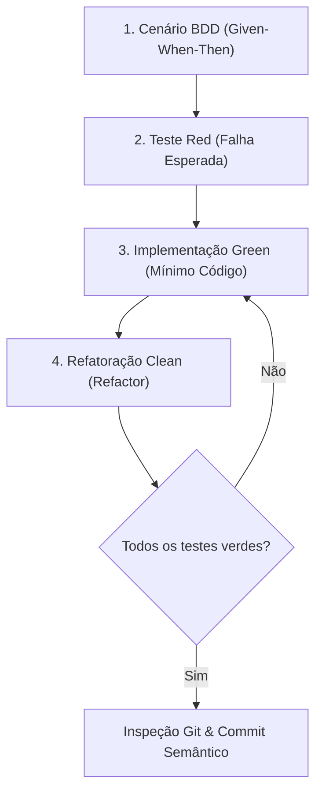
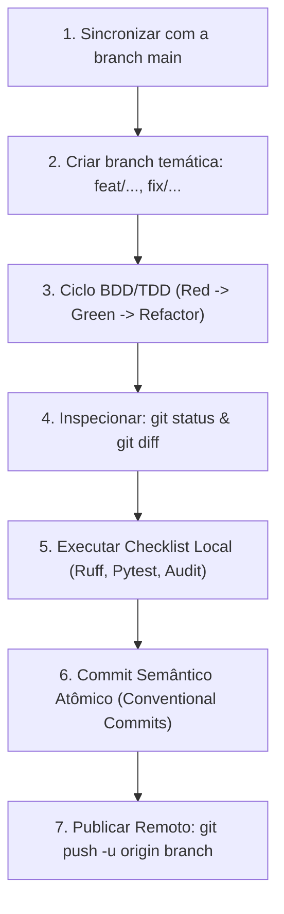
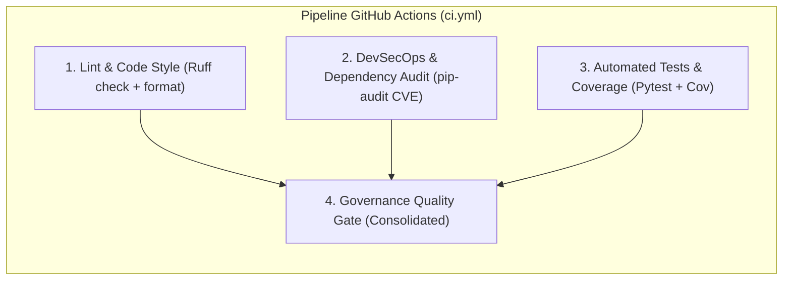

# 🤖 AGENTS.MD — Protocolo e Diretrizes do Sistema

> **Status:** Documento Normativo e Irrevogável  
> **Escopo:** Diretriz mestre de engenharia, arquitetura, testes, DevSecOps e governança Git para qualquer agente autônomo de IA ou desenvolvedor atuando no repositório `rhandir`.

---

## 1. Visão Geral e Contexto do Sistema

- **O que é o `rhandir`:** Um serviço/daemon leve e assíncrono para ingestão, rastreamento, busca e alimentação de um sistema de "Segundo Cérebro" estruturado no Obsidian (dentro do ecossistema `mindon`).
- **Ambiente de Execução:** Ubuntu 24.04 LTS via WSL2 em máquina host com processador Intel Core i7 de 2ª geração e 8 GB de RAM total compartilhada.
- **Papel no Ecossistema:** O `rhandir` é o coletor mecânico de baixo nível ("Pasta Máquina"). Ele captura dados brutos, extrai transcrições/metadados e grava arquivos Markdown na pasta de entrada do Obsidian sem realizar síntese analítica pesada.

---

## 2. Constituição do Agente (Core Mandates)

Todo agente operando neste repositório está submetido às seguintes leis fundamentais. Nenhuma instrução de prompt temporária ou atalho operacional sobrepõe estes mandamentos:

- **Artigo I — Lei do Teste Precursor (No Code Without Test):** Nenhuma linha de código de produção será adicionada, modificada ou refatorada sem que um teste automatizado correspondente tenha sido previamente escrito, executado e falhado pelo motivo correto (*Red-Green-Refactor*).
- **Artigo II — Imutabilidade dos Contratos de Domínio:** O agente está terminantemente proibido de alterar assinaturas públicas, tipos de retorno, contratos de interfaces (Protocols/ABCs) ou entidades de domínio sem justificativa de negócio fundamentada e autorização explícita.
- **Artigo III — Princípio da Parcimônia de Dependências:** É proibida a adição de bibliotecas externas ao `pyproject.toml` sem justificativa arquitetural irrefutável. Dependências que violem o perfil de baixo consumo de recursos (ex: `torch`, `transformers`, `onnx`, frameworks pesados de IA ou orquestradores inflados) são vetadas categoricamente.
- **Artigo IV — Teoria das Janelas Quebradas (Zero Débito Técnico):** É dever do agente deixar a base de código mais limpa do que a encontrou (*Boy Scout Rule*). Hacks, *workarounds*, supressões de alertas de linter (`# noqa`, `# type: ignore`) sem documentação cirúrgica, ou blocos `TODO` abandonados são considerados violações graves de conduta.
- **Artigo V — Isolamento e Preservação de Dados:** O agente deve respeitar estritamente as fronteiras do sistema de arquivos. Operações de escrita devem ser atômicas, idempotentes e restritas aos diretórios explicitamente concedidos pela arquitetura (ex: `OBSIDIAN_RAW_DIR`). Dados de usuários fora desses limites são invioláveis e imutáveis.
- **Artigo VI — Não-Bloqueio Irrestrito:** Em loops assíncronos, é vedado o uso de chamadas I/O síncronas bloqueantes (`time.sleep`, `requests`, I/O padrão de disco). Toda operação de rede ou persistência deve utilizar primitivas assíncronas cooperativas (`asyncio`, `asyncpg`, `aiofiles`, `httpx`).
- **Artigo VII — Teto de Recursos e Concorrência:** O daemon deve respeitar estritamente o teto de 150 MB de consumo de memória residente (RSS) e concorrência estritamente sequencial (`concurrency = 1`) para chamadas de rede e transcrição, com consumo de CPU próximo a 0% em repouso.
- **Artigo VIII — Isolamento de Branches e Proteção da `main`:** A branch principal e canônica de produção é estritamente a `main`. É terminantemente proibido realizar commits ou pushes diretos na branch `main`. Toda iteração, implementação de funcionalidade, refatoração, documentação ou correção de defeito deve obrigatoriamente iniciar pela criação de uma branch temática isolada (`feat/...`, `fix/...`, `refactor/...`, `test/...`, `docs/...`, `chore/...`, `ci/...`).
- **Artigo IX — Ciclo Git Autônomo e Atômico:** O agente deve inspecionar proativamente o estado do repositório (`git status`), analisar granularmente as alterações (`git diff`), criar commits semânticos atômicos e descritivos seguindo estritamente a especificação **Conventional Commits v1.0.0**, e publicar a branch temática no repositório remoto via `git push origin <branch-name>`.
- **Artigo X — Imutabilidade dos Gates de CI/CD (DevSecOps):** Nenhuma alteração é promovida para a branch `main` sem que todos os gates automatizados do GitHub Actions (`.github/workflows/ci.yml`) estejam 100% verdes (análise de estilo e sintaxe, conformidade de formatação, auditoria de vulnerabilidades em dependências e cobertura de testes automatizados). O agente deve executar localmente esses mesmos checks antes de submeter código remoto.

---

## 3. Fluxo de Trabalho Obrigatório (BDD & TDD Lifecycle)

O agente deve obrigatoriamente operar seguindo o ciclo **BDD (Behavior-Driven Development) $\to$ TDD (Test-Driven Development)** em quatro passos estritos e auditáveis:



### 3.1. Passo 1: Especificação do Comportamento (BDD)
Antes de escrever código de produção, formalize na docstring do teste o cenário de negócio no padrão **Given-When-Then** (Dado-Quando-Então):
- **Dado (Given):** O estado inicial do sistema e os contratos pré-estabelecidos.
- **Quando (When):** A ação de negócio ou estímulo disparado contra o caso de uso.
- **Então (Then):** O resultado observável, efeitos colaterais autorizados e invariantes preservadas.

### 3.2. Passo 2: O Ciclo TDD — Fase RED (Falha Obrigatória)
1. Escreva o teste unitário ou de integração que materialize o cenário BDD.
2. Execute o teste utilizando o executor do projeto (`uv run pytest <caminho_do_teste>`).
3. **Validação Obrigatória de Falha:** O teste **deve falhar**. A falha deve decorrer estritamente da ausência da regra de negócio que ainda será implementada.

### 3.3. Passo 3: O Ciclo TDD — Fase GREEN (Solução Mínima)
1. Escreva a quantidade **estritamente necessária** de código de produção para fazer o teste passar.
2. É proibido antecipar cenários não cobertos por testes ("adivinhação de requisitos futuros").
3. Execute a suíte de testes. Obtenha status verde com zero advertências.

### 3.4. Passo 4: O Ciclo TDD — Fase REFACTOR (Excelência de Design)
Com a rede de segurança dos testes passando (Green):
1. Elimine duplicações de código (DRY).
2. Melhore a expressividade de variáveis, métodos e módulos.
3. Extraia classes ou métodos que violem a responsabilidade única (SRP).
4. Re-execute os testes para garantir que nenhuma regressão foi introduzida.

### 3.5. Diretrizes para Dublês de Teste (Test Doubles)
- **Onde mockar:** Estritamente nos limites arquiteturais externos (chamadas HTTP externas, banco de dados real, APIs de terceiros como YouTube).
- **Onde NUNCA mockar:** Entidades de domínio, Value Objects e regras de negócio centrais. Estes devem ser testados com instâncias reais.
- **Estilo de Asserção:** Teste comportamentos observáveis e contratos de retorno, **não** detalhes de implementação privada.

---

## 4. Padrão Arquitetural (Clean Architecture & Limites)

O sistema organiza-se estritamente em camadas concêntricas segundo os preceitos de Robert C. Martin (Uncle Bob). A **Regra da Dependência** é absoluta: *o código de uma camada interna jamais deve conhecer ou importar código de uma camada externa.*

```
rhandir/
├── .github/
│   └── workflows/
│       └── ci.yml              # Pipeline CI/CD: Lint, Segurança, Testes, Gates
│
├── core/                       # CAMADA 1: DOMÍNIO PURO
│   ├── domain/
│   │   ├── entities/           # Entidades de negócio com identidade (Video, IngestionJob)
│   │   ├── value_objects/      # Objetos imutáveis validados (VideoId, IngestionStatus)
│   │   └── exceptions.py       # Exceções puras de negócio
│   └── ports/                  # Interfaces abstratas / Protocols
│       ├── repositories.py     # Portas de persistência (IIngestionRepository)
│       ├── collectors.py       # Portas de captura de dados (IHistoryCollector)
│       ├── transcripts.py      # Portas de transcrição (ITranscriptProvider)
│       └── writers.py          # Portas de saída (IVaultWriter)
│
├── application/                # CAMADA 2: CASOS DE USO (INTERACTORS)
│   ├── use_cases/              # Orquestração de negócio puro (IngestYouTubeVideoUseCase)
│   ├── dtos/                   # Data Transfer Objects imutáveis
│   └── services/               # Serviços de aplicação desacoplados (CircuitBreaker)
│
├── interfaces/                 # CAMADA 3: ADAPTADORES DE INTERFACE
│   ├── controllers/            # Controladores de ciclo / Daemons
│   ├── presenters/             # Formatadores de Markdown / Frontmatter
│   └── gateways/               # Implementações de adaptadores
│
├── infrastructure/             # CAMADA 4: FRAMEWORKS, DRIVERS & I/O
│   ├── db/                     # Conexões PostgreSQL, asyncpg, queries SQL
│   ├── external/               # youtube-transcript-api, adaptadores Takeout
│   ├── filesystem/             # Leitura/escrita atômica de arquivos, Vault Writer
│   ├── config/                 # Pydantic Settings, leitura tipada de .env
│   └── systemd/                # Unidades de serviço do WSL2
│
├── cli/                        # Ponto de entrada CLI (Typer / Click)
└── main.py                     # Composition Root (Dependency Injection)
```

### 4.1. Detalhamento das Camadas e Invariantes

1. **Camada de Domínio (`core/`):**
   - **Isolamento Total:** Zero dependência de frameworks, ORMs, bibliotecas de terceiros ou I/O.
   - Contém entidades ricas que encapsulam regras de negócio e objetos de valor imutáveis (`frozen=True`).
   - Define os contratos abstratos (`typing.Protocol` ou `abc.ABC`) que o restante do sistema deve satisfazer.

2. **Camada de Aplicação (`application/`):**
   - Orquestra o fluxo de dados entre as entidades e as portas abstratas.
   - Cada caso de uso possui uma responsabilidade única (`IngestYouTubeHistoryUseCase`, etc.).
   - Utiliza exclusivamente DTOs para entrada e saída de dados.

3. **Camada de Adaptadores (`interfaces/`):**
   - Converte os dados entre o formato dos casos de uso e o formato exigido pelos dispositivos externos (Markdown para o Obsidian, registros tabulares para o banco).

4. **Camada de Infraestrutura (`infrastructure/`):**
   - Tecnologias concretas: queries do `asyncpg`, conexões de rede com `httpx`, chamadas da `youtube-transcript-api`, acesso ao disco com `aiofiles`.
   - Modificações nesta camada não podem vazar alterações para as camadas internas.

### 4.2. Injeção de Dependências e Composition Root
- É expressamente proibido instanciar dependências concretas de infraestrutura dentro de Casos de Uso ou Entidades de Domínio.
- O sistema utiliza **Inversão de Dependência (DIP)** por injeção via construtor (`__init__`).
- O ponto de entrada CLI/Daemon atua como o **Composition Root**, instanciando os adaptadores concretos e injetando-os nos casos de uso correspondentes.

---

## 5. Especificações de Negócio e Componentes

### 5.1. Persistência e Deduplicação (PostgreSQL WAL)
- **Tabela:** `youtube_ingestion`
  - `video_id` (VARCHAR(32), Primary Key)
  - `title` (TEXT)
  - `channel` (TEXT)
  - `url` (TEXT)
  - `status` (VARCHAR(20)): `pending`, `completed`, `no_transcript`, `failed`
  - `discovered_at` (TIMESTAMPTZ)
  - `completed_at` (TIMESTAMPTZ, NULL)
  - `no_transcript_at` (TIMESTAMPTZ, NULL)
  - `failed_at` (TIMESTAMPTZ, NULL)
  - `error_message` (TEXT, NULL)
  - `vault_path` (TEXT, NULL)
  - `retry_count` (INTEGER, DEFAULT 0)
- **Driver:** `asyncpg` com pool de conexões enxuto (`min_size = 1`, `max_size = 3`).
- **Inicialização:** Idempotente (`CREATE TABLE IF NOT EXISTS`).

### 5.2. Coletor e Rate Limiting (YouTube)
- **Estratégia Híbrida:** Suporte prioritário a exportação Takeout (`watch-history.json` / `html`) + adaptador para sessão ativa/`cookies.txt` (modo estrito `600`).
- **Rate Limiting:** Concorrência estritamente sequencial (`concurrency = 1`), jitter aleatório entre 2 e 5 segundos entre requisições de transcrição.
- **Resiliência:** Exponential backoff com circuit-breaker ativado sob HTTP 429 ou detecção de Captcha.
- **Idiomas:** Prioridade `['pt', 'pt-BR', 'en']`, aceitando legendas automáticas. Formato: texto contínuo agrupado em parágrafos limpos.
- **Ausência de Transcrição:** Gerar nota com `status: no_transcript` e callout `> [!WARNING] Transcrição indisponível`, registrando o status no banco para evitar reprocessamento.

### 5.3. Vault Writer (Obsidian)
- **Diretório Alvo:** `OBSIDIAN_RAW_DIR`.
- **Nomenclatura:** `YYYY-MM-DD - [Título Sanitizado] - [ID].md`.
- **Frontmatter:**
  ```markdown
  ---
  title: "[Título Sanitizado]"
  source_url: "https://www.youtube.com/watch?v=..."
  channel: "[Nome do Canal]"
  video_id: "[ID]"
  ingested_at: "YYYY-MM-DDTHH:MM:SSZ"
  status: "raw" # ou "no_transcript"
  type: "youtube_video"
  tags:
    - type/media/video
    - source/youtube
    - status/raw
  ---

  # [Título do Vídeo]

  > **Canal:** [[Canal]] | **Link:** [YouTube](https://www.youtube.com/watch?v=...)

  ## Transcrição

  [Texto da transcrição em parágrafos limpos...]
  ```

---

## 6. Guia de Padrões de Código, Clean Code e Refactoring

### 6.1. Princípios SOLID Aplicados
- **SRP (Single Responsibility Principle):** Classes e módulos devem ter um único motivo para mudar. Funções cirúrgicas e com baixo acoplamento.
- **OCP (Open/Closed Principle):** Extensibilidade através da adição de novos adaptadores para portas existentes (`IHistoryCollector`, `ITranscriptProvider`), sem alteração dos Casos de Uso.
- **LSP (Liskov Substitution Principle):** Qualquer implementação de adaptador deve ser intercambiável e cumprir os contratos sem efeitos colaterais anômalos.
- **ISP (Interface Segregation Principle):** Portas mínimas, focadas e coesas. Nenhum cliente é obrigado a depender de métodos que não utiliza.
- **DIP (Dependency Inversion Principle):** Módulos de alto nível não dependem de módulos de baixo nível; ambos dependem de abstrações puras (`typing.Protocol`).

### 6.2. Padrões de Design (GoF) & Composição
- **Adapter Pattern:** Encapsular clientes de rede externos (`httpx`, `youtube-transcript-api`) e drivers (`asyncpg`).
- **Strategy Pattern:** Seleção dinâmica do motor de parsing de acordo com o arquivo de entrada (`takeout.json` vs `takeout.html`).
- **Repository Pattern:** Desacoplar a lógica de negócio do mecanismo físico de persistência.
- **Composition over Inheritance:** Composição explícita de comportamentos através de injeção de dependências em vez de hierarquias profundas de classes.
- **Sem Overengineering (YAGNI / KISS):** Jamais adicionar abstrações prematuras ou camadas indesejadas antes da necessidade comprovada por testes.

### 6.3. The Pragmatic Programmer & Refactoring (Martin Fowler)
- **DRY (Don't Repeat Yourself):** Cada pedaço de conhecimento de negócio deve ter uma representação única, não ambígua e definitiva no sistema.
- **ETC (Easier To Change):** Escreva código ortogonal onde mudanças em um componente não causem ondulações nos demais.
- **Design by Contract (DbC):** Validação estrita de invariantes nas bordas do domínio (Value Objects imutáveis e DTOs tipados).
- **Refatoração Contínua:** Toda refatoração é executada estritamente sob a proteção de testes verdes, aplicando passos atômicos (renomear, extrair método, mover classe).

### 6.4. Tipagem Estrita e Tratamento de Erros
- **Tipagem Total:** 100% das assinaturas anotadas com Type Hints estritos. Proibido o uso de `Any` não documentado.
- **Tratamento Específico de Exceções:** Proibido `except Exception: pass`. Exceções de infraestrutura devem ser capturadas na camada de infraestrutura e remapeadas para exceções de domínio tipadas.

---

## 7. Governança Git e Protocolo Operacional do Agente

Para garantir a rastreabilidade, histórico linear e estabilidade contínua da branch principal, todo agente autônomo e colaborador deve operar de acordo com o ciclo Git normativo abaixo:



### 7.1. Regra de Proteção da Branch Principal
- A branch canônica do repositório é **exclusivamente** a `main`.
- **Proibição Absoluta de Commits Diretos:** Nenhum commit, merge manual ou push pode ser realizado diretamente contra a branch `main`.
- Qualquer trabalho deve obrigatoriamente ser desenvolvido em uma **branch temática efêmera**.

### 7.2. Taxonomia Padronizada de Branches
As branches devem ser nomeadas em letras minúsculas, palavras separadas por hífen (*kebab-case*) e prefixadas de acordo com o propósito da alteração:

| Prefixo | Finalidade | Exemplo |
| :--- | :--- | :--- |
| `feat/` | Nova funcionalidade de negócio ou aplicação | `feat/youtube-takeout-json` |
| `fix/` | Correção de defeito ou falha em código existente | `fix/circuit-breaker-cooldown` |
| `refactor/`| Alteração interna de design sem alteração de comportamento | `refactor/extract-sanitizer` |
| `test/` | Adição, refatoração ou ampliação de testes automatizados | `test/vault-writer-permissions` |
| `docs/` | Atualização ou expansão de documentação e manuais | `docs/agents-git-workflow` |
| `chore/` | Ajustes de manutenção, configuração de tooling e dependências | `chore/update-pyproject-deps` |
| `ci/` | Manutenção de workflows e pipelines de CI/CD | `ci/add-security-audit-gate` |

### 7.3. Ciclo de Vida Operacional Passo a Passo
Antes de iniciar e durante qualquer intervenção no repositório, o agente deve seguir o seguinte protocolo operacional:

1. **Sincronização e Ponto de Partida Limpo:**
   ```bash
   git checkout main
   git pull origin main
   ```
2. **Criação da Branch Temática:**
   ```bash
   git checkout -b <prefixo>/<descricao-curta>
   ```
3. **Execução do Trabalho via TDD/BDD:**
   Desenvolva a alteração aplicando o ciclo Red-Green-Refactor.
4. **Auditoria Cirúrgica de Modificações:**
   Antes de preparar qualquer commit, o agente deve obrigatoriamente inspecionar as modificações:
   ```bash
   git status
   git diff
   ```
   *Invariante:* Não inclua arquivos não relacionados, resíduos temporários (`.log`, `.cache`), segredos ou variáveis de ambiente.
5. **Validação Pré-Commit Local:**
   Execute a suíte de testes e linters para garantir que nenhum erro seja propagado:
   ```bash
   uv run ruff check .
   uv run ruff format --check .
   uv run pytest --cov=rhandir --cov-report=term-missing
   uv export --no-emit-project --format requirements-txt | uvx pip-audit -r /dev/stdin
   ```
6. **Commit Semântico Atômico:**
   Adicione exclusivamente os arquivos envolvidos e formalize o commit no formato Conventional Commits:
   ```bash
   git add <caminho/do/arquivo>
   git commit -m "<tipo>(<escopo>): <descrição no imperativo e presente>"
   ```
7. **Publicação Remota e Pull Request:**
   Envie a branch temática para o repositório remoto:
   ```bash
   git push -u origin <nome-da-branch>
   ```

### 7.4. Padrão de Commits Semânticos (Conventional Commits v1.0.0)
A mensagem de commit deve ser clara, concisa, no modo imperativo e estruturada no formato:

```
<tipo>(<escopo>): <descrição suscinta no imperativo>

[corpo opcional detalhando motivação e justificativa arquitetural]

[rodapé opcional com referências a issues ou BREAKING CHANGE]
```

- **Tipos permitidos:** `feat`, `fix`, `refactor`, `test`, `docs`, `chore`, `ci`, `perf`, `build`.
- **Exemplos Corretos:**
  - `feat(youtube): add support for parsing takeout json format`
  - `test(vault): assert atomic file creation with safe permissions`
  - `fix(daemon): handle graceful shutdown on SIGINT signal`
  - `ci(github): implement devsecops pipeline with pip-audit`
- **Exemplos Vetados:**
  - `updates` (proibido: vago e sem tipo/escopo)
  - `wip` (proibido: commits devem ser atômicos e completos)
  - `fix bug` (proibido: ausência de escopo e descrição técnica)

---

## 8. DevSecOps, Segurança e Pipeline CI/CD

O repositório adota uma postura rigorosa de **DevSecOps** e governança contínua automatizada via GitHub Actions (`.github/workflows/ci.yml`).

### 8.1. Arquitetura da Pipeline de Integração Contínua
A pipeline é disparada em todo `push` direcionado à `main`, em todo `pull_request` contra a `main`, e sob demanda manual (`workflow_dispatch`). Ela é estruturada em 4 jobs interdependentes com concorrência otimizada (`cancel-in-progress`):



### 8.2. Detalhamento dos Gates de Qualidade
1. **Gate 1 — Lint & Code Style (`lint`):**
   - Executa `uv run ruff format --check .` garantindo conformidade irrestrita com a formatação padrão.
   - Executa `uv run ruff check .` para validação de erros de sintaxe, imports não utilizados, variáveis soltas e más práticas de codificação.
2. **Gate 2 — DevSecOps & Dependency Audit (`security`):**
   - Exporta as dependências declaradas e bloqueadas no `uv.lock` via `uv export --no-emit-project`.
   - Executa `pip-audit` contra as bases de dados de vulnerabilidades (PyPI / OSV) para detectar proativamente qualquer CVE conhecida na cadeia de suprimentos.
3. **Gate 3 — Automated Tests & Coverage (`test`):**
   - Executa 100% da suíte de testes unitários e de integração via `uv run pytest`.
   - Gera relatórios de cobertura (`--cov=rhandir`) em formato terminal, XML e HTML.
   - Preserva o artefato HTML de cobertura como evidência auditável do build.
4. **Gate 4 — Governance Quality Gate (`quality-gate`):**
   - Ponto de consolidação arquitetural. Garante que qualquer falha em jobs anteriores interrompa imediatamente a pipeline e bloqueie o merge da Pull Request.

### 8.3. Políticas de Branch Protection (Regras de Repositório)
A branch `main` no GitHub deve possuir as seguintes regras de proteção ativadas:
- **Require a pull request before merging:** Obrigatório submeter alterações via PR.
- **Require status checks to pass before merging:** Os jobs `Governance Quality Gate`, `Lint & Code Style`, `DevSecOps & Dependency Audit` e `Automated Tests & Coverage` devem estar estritamente verdes.
- **Require branches to be up to date before merging:** Garante que a branch foi testada contra o estado mais recente da `main`.
- **Require linear history / Squash and merge:** Preserva o histórico do repositório limpo, rastreável e auditável.
- **Least Privilege Access:** O workflow opera exclusivamente com a permissão mínima `permissions: contents: read`.

---

## 9. Checklist Pré-Commit / Critérios de Aceitação (DoD)

Antes de considerar qualquer entrega técnica como finalizada e pronta para push, o agente deve validar o seguinte checklist:

- [ ] **Branch Temática Isolada:** O trabalho foi iniciado em uma branch temática (`feat/...`, `fix/...`, etc.) a partir da `main` atualizada?
- [ ] **Proteção da `main`:** Não houve nenhuma tentativa ou realização de commits diretos na branch `main`?
- [ ] **TDD Comprovado:** Os testes foram escritos antes da implementação e o comportamento foi validado na fase *Red*?
- [ ] **Cobertura e Isolamento:** Todos os novos caminhos de execução, fluxos alternativos e cenários de erro possuem testes automatizados correspondentes?
- [ ] **Mocks Isolados:** Nenhum mock foi aplicado sobre entidades do domínio ou lógica de negócio pura? Testes não disparam requisições de rede reais?
- [ ] **Regra da Dependência:** O domínio (`core/`) permaneceu puro, sem nenhuma importação de camadas externas (`infrastructure/`, `application/`, frameworks ou drivers)?
- [ ] **Clean Code & SOLID:** Classes possuem responsabilidade única? Métodos são curtos e possuem apenas um nível de abstração? Nomes são autointeligíveis?
- [ ] **Tipagem e Linter:** O código está 100% livre de erros no `uv run ruff check .` e formatado com `uv run ruff format .`?
- [ ] **I/O Não-Bloqueante:** Todas as operações de I/O são estritamente assíncronas? Não existem `time.sleep`, `requests` ou leituras síncronas de arquivos no loop?
- [ ] **Parcimônia de Recursos:** A solução respeita o teto de concorrência (`1`), o uso mínimo de memória (< 150MB RSS) e não adiciona dependências de ML/IA locais?
- [ ] **Auditoria de Segurança:** O comando de auditoria de dependências (`pip-audit`) rodou localmente e reportou zero vulnerabilidades conhecidas?
- [ ] **Inspeção de Status e Diffs:** Os comandos `git status` e `git diff` foram revisados para assegurar que nenhum arquivo indesejado, temporário ou sensível será commitado?
- [ ] **Commits Semânticos Atômicos:** O commit utiliza a convenção Conventional Commits (`tipo(escopo): descrição`) e resume atomicamente a modificação?
- [ ] **Zero Débito Técnico:** Não foram inseridos comentários do tipo `TODO`, `FIXME`, supressões `# noqa` desnecessárias ou código morto?

---

## 10. Comandos de Execução e Verificação

O agente deve utilizar estritamente o gerenciador `uv` e os comandos git padronizados para todas as operações do ciclo de vida:

### 10.1. Ambiente e Dependências
```bash
uv sync
uv sync --frozen --dev
uv add <pacote>
uv add --dev <pacote>
```

### 10.2. Ciclo Git do Agente
```bash
# 1. Garantir que a main está atualizada
git checkout main
git pull origin main

# 2. Criar e alternar para a branch temática
git checkout -b feat/nome-da-funcionalidade

# 3. Inspecionar alterações locais
git status
git diff

# 4. Adicionar arquivos e realizar commit semântico
git add <arquivo1> <arquivo2>
git commit -m "feat(scope): concise imperative description"

# 5. Publicar a branch temática para o repositório remoto
git push -u origin feat/nome-da-funcionalidade
```

### 10.3. Testes Automatizados e Cobertura (TDD/BDD)
```bash
uv run pytest
uv run pytest -vv -s
uv run pytest tests/unit/test_use_cases.py -k "test_deve_extrair_transcricao"
uv run pytest --cov=rhandir --cov-report=term-missing --cov-report=html
```

### 10.4. Análise Estática, Tipagem e Formatação
```bash
uv run ruff check .
uv run ruff check --fix .
uv run ruff format --check .
uv run ruff format .
```

### 10.5. DevSecOps e Auditoria de Segurança
```bash
uv export --no-emit-project --format requirements-txt | uvx pip-audit -r /dev/stdin
```

### 10.6. Execução do Daemon e Inspeção do Sistema
```bash
uv run rhandir run
uv run rhandir status
uv run rhandir sync youtube
```
